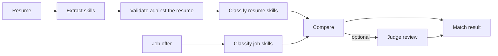

# Resume Agent

An AI assistant for a personal website, built from two earlier prototypes. It does two things with a resume:

1. **Chat**: visitors ask about the person's experience and skills, and the assistant answers only from the resume.
   When it does not know, it records the question; when a visitor wants to get in touch, it records their email.
2. **Match a job offer**: paste a job description and get the required skills compared with the resume, an overall fit
   score, strengths, gaps, and optionally a second model call (a *judge*) that reviews the result.

The person's real details live **outside the repository**. The repo contains only a fictional example (`examples/`).

## How it works



- **Chat** (`chat.py`): a tool-calling loop over an OpenAI-compatible API with two tools, `record_user_details` and
  `record_unknown_question`. Events go to a local `leads.jsonl` and, if configured, to Pushover.
- **Matching** (`matching/`): a LangGraph pipeline. The resume branch (extract, validate, classify) and the job branch
  (classify) run **in parallel** and meet at the comparison; the judge is an optional last node.
- **One LLM wrapper** (`llm.py`): retries transient errors with backoff, rejects bad keys at once, and raises a clear error
  instead of returning `None`.

## Quick start

```bash
uv sync
cp .env.example .env                       # add OPENAI_API_KEY (or type a key in the app)
mkdir profile && cp examples/profile/* profile/    # then replace the files with your own resume

uv run resume-agent serve                  # web app: chat + job match
uv run resume-agent match examples/job.txt --judge   # or from the terminal
```

Your profile folder holds `resume.pdf` (or `.txt`/`.md`), an optional `summary.txt` and an optional `profile.json`
(`{"name": "..."}`). It is git-ignored, so your CV never reaches the repository.

| Variable | Purpose |
|---|---|
| `OPENAI_API_KEY` | API key. In the app a visitor can type their own instead |
| `OPENAI_BASE_URL` | Optional: use OpenRouter or any OpenAI-compatible server |
| `LLM_MODEL` | Model id, default `gpt-4o-mini` |
| `RESUME_PROFILE_DIR` | Profile folder, default `profile` |
| `PUSHOVER_TOKEN`, `PUSHOVER_USER` | Optional push notifications |

## Key decisions

- **It says it is an AI.** The first prototype played the person ("you are Justine…"). This one represents them in the third
  person, says it is an AI assistant if asked, and may only use the resume: it never invents employers, dates or numbers.
- **The model can call only two named functions.** The first prototype ran `globals().get(tool_name)`, so a model (or a
  prompt-injected visitor) could have called any function in the program. Tools are now an explicit registry, arguments are
  validated, and visitor messages are declared to be questions, not instructions.
- **Visitors bring their own key.** The key is passed to each request and never written to `os.environ`, which every
  session of a web app shares, so the author pays for nothing and two visitors cannot see each other's key.
- **Failures are loud.** A failed model call stops the run with an error; the old matcher passed `None` into the next prompt.
- **One OpenAI-compatible client** replaces the separate OpenAI and Gemini code paths. Point `OPENAI_BASE_URL` at any
  compatible endpoint (including Gemini's) instead of maintaining several SDKs.

## Tests

```bash
uv run pytest
```

The tests use a scripted model, so they need no key or network: the retry and error behaviour, the tool loop (valid and
invalid emails, unknown tools, malformed arguments, a model stuck calling tools), history cleaning, profile loading
including a PDF, the parallel pipeline with and without the judge, and the Markdown rendering. CI runs lint and tests.

## Limitations

- The answers come from a language model. Matching scores are **an aid, not a hiring decision**; the judge is another
  model call and can also be wrong.
- Skills are extracted from the text with prompts, so unusual layouts or very long resumes can degrade results.
- The matching prompts are long and English-oriented; they were carried over from the prototype and tuned only lightly.
- There is no hosted demo yet and no HTTP API. The web app runs locally with `resume-agent serve`.
- Your leads file (`leads.jsonl`) contains visitors' emails: protect it and respect privacy rules where you deploy.

## Origins

Merges `resume-chatbot` (chat with tools) and `langgraph-resume-skills-matcher` (LangGraph skills matching with a judge).
